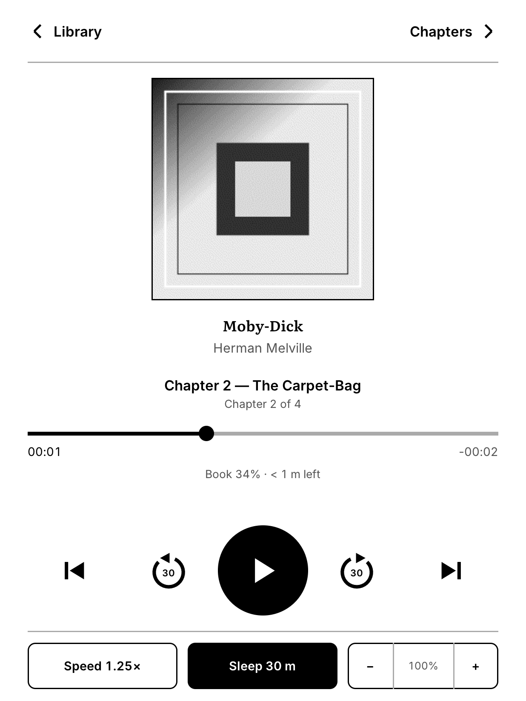
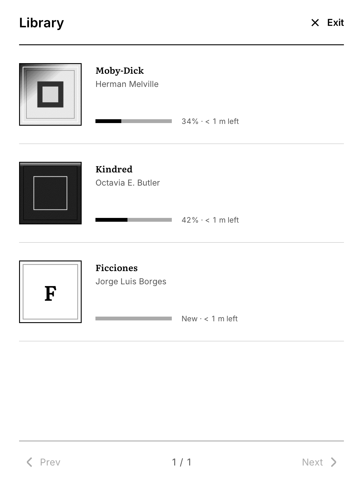
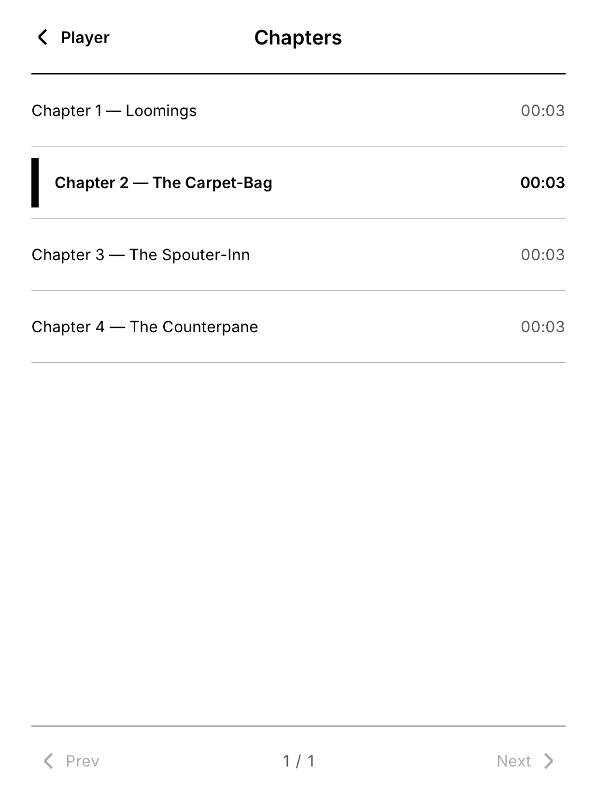
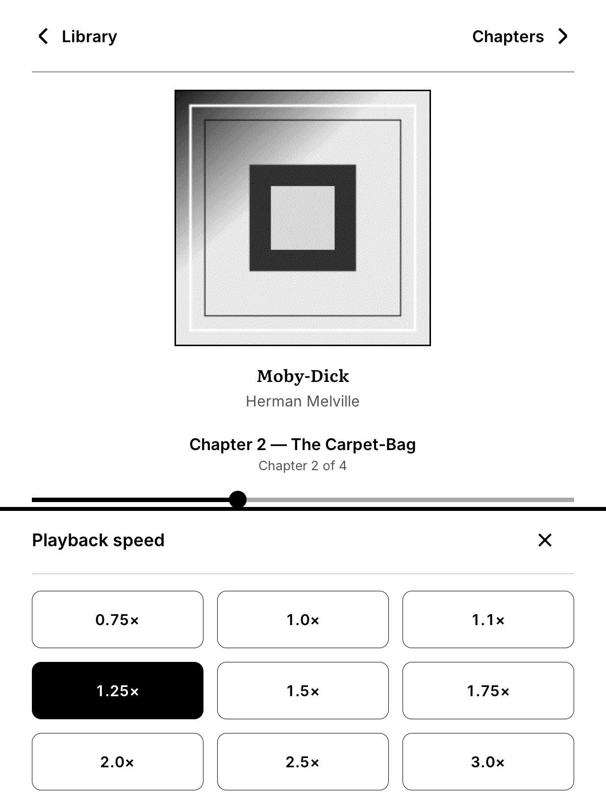
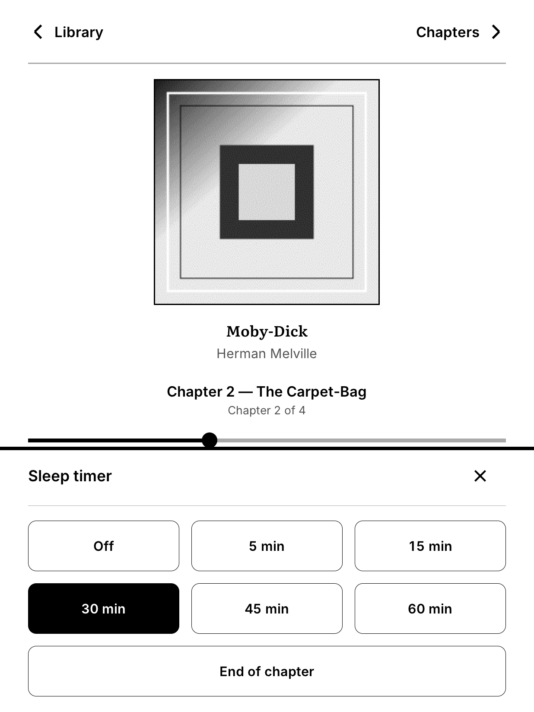
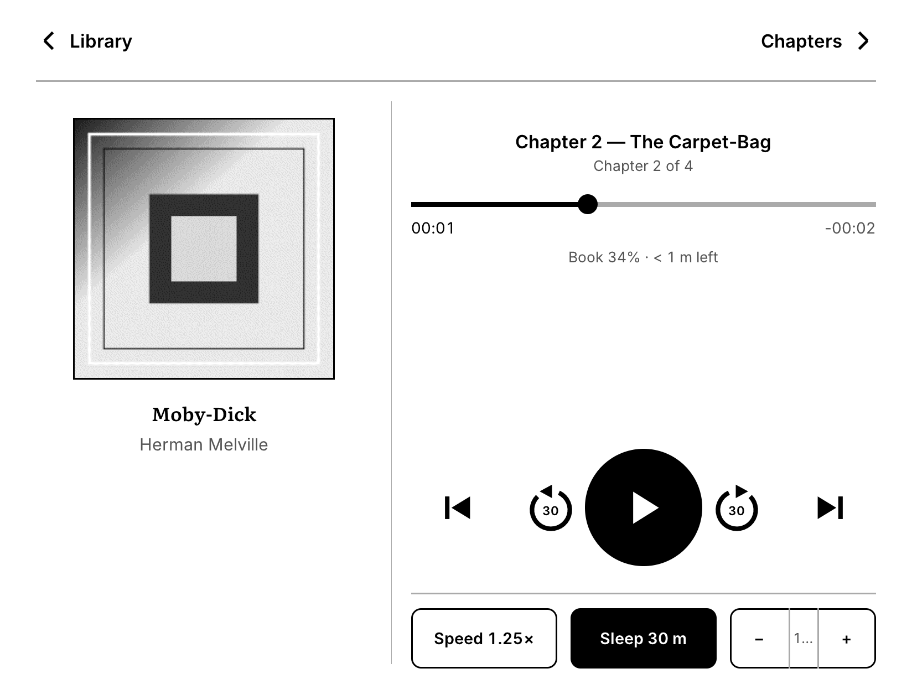

# Aloud

A minimal, battery-friendly standalone audiobook player for jailbroken Amazon Kindles (FW 5.x).



## Features

- **Play your own DRM-free audiobooks** — single-file `.m4b` / `.m4a` / `.mp3` / `.ogg` / `.opus` / `.flac` or multi-file chapter folders (with natural chapter ordering so `Chapter 2` comes before `Chapter 10`).
- **Works across Kindle audio architectures:**
  - **Bluetooth Kindles** (Kindle 8+, Paperwhite 4/5/6, Oasis 1/2/3, Scribe, Colorsoft): streams 44.1 kHz S16LE stereo into the stock firmware's GStreamer `mixersink` via a tiny dynamic helper (`aloud-sink-armel` / `aloud-sink-armhf`) that auto-selects GStreamer 1.0 or 0.10 and soft- or hard-float ABI.
  - **Kindle Touch** (3.5 mm headphone jack + speakers): drives `/dev/snd/pcmC0D0p` directly via raw Linux kernel ALSA ioctls with zero userspace `libasound` dependency.
- **Fail-proof position persistence:** atomic `write` → `fsync` → `rename` into `positions.tsv` with `.bak` fallback and corruption recovery. Automatically rewinds 2 seconds when resuming after a pause.
- **Pitch-preserving playback speed (`0.75×`–`3.0×`)** powered by `sonic`, plus a **Sleep Timer** (`15` / `30` / `45` / `60` / `90 min` or `End of chapter`) with a smooth 10-second fade-out.
- **Designed for e-ink & battery life:**
  - Zero CPU wakeups when paused (`poll(..., -1)`).
  - Once-per-minute progress refresh while playing using fast non-flashing `DU` waveforms; full `GC16` flashing refresh only on screen transitions or every 15 minutes.
  - Allows the Kindle screensaver while playing and defers deep suspend (`com.lab126.powerd` `deferSuspend`) until playback pauses or the sleep timer finishes.
  - Physical-millimetre layout that adapts cleanly to 300 DPI (Paperwhite / Oasis / Voyage), 167 DPI (Kindle Basic / Touch), and 2-column Landscape mode.

## Screens

| Library | Player (300 DPI) | Chapters |
| :---: | :---: | :---: |
|  |  |  |

| Speed Sheet | Sleep Timer Sheet | Landscape & 167 DPI (KT4) |
| :---: | :---: | :---: |
|  |  |  |

## Installation (Jailbroken Kindle)

1. Ensure your Kindle is jailbroken with the hotfix installed (see [kindlemodding.org](https://kindlemodding.org)).
2. Build or download `dist/aloud-0.1.0.zip` and unzip it directly onto the root of your Kindle's USB drive (`/mnt/us/`):
   - `documents/Aloud.sh` — Library scriptlet launcher (works on all FW 5.x, including FW ≥ 5.19.4 where KUAL Kindlets are blocked).
   - `extensions/aloud/` — application binaries, fonts, and KUAL extension entry.
   - `audiobooks/` — drop your `.m4b` files or audiobook folders here.
3. Eject your Kindle and tap **Aloud** in your Kindle Library (or launch it from **KUAL → Aloud**).

See [docs/DEVICE-TESTING.md](docs/DEVICE-TESTING.md) for the step-by-step hardware verification checklist and diagnostic scripts.

## Building from Source

Requires `zig` (`0.17+`, used as the hermetic C/ARMv7 cross-compiler) and host `ffmpeg` (for generating test fixtures).

```sh
# 1. Fetch pinned dependencies (FBInk, FFmpeg 9.0.2, sonic, stb, Literata & Inter OFL fonts)
./scripts/fetch-deps.sh

# 2. Build minimal static FFmpeg for host and Kindle ARMv7 (NEON+VFP)
./scripts/build-ffmpeg.sh host
./scripts/build-ffmpeg.sh kindle

# 3. Run the 121-check unit & integration test suite
make test

# 4. Render golden UI screenshots on host simulator
make sim

# 5. Cross-compile Kindle binaries and package dist/aloud-0.1.0.zip
make package
```

## License

GPL-3.0-or-later. Uses [FBInk](https://github.com/NiLuJe/FBInk) (GPL-3.0+),
[FFmpeg](https://ffmpeg.org) (LGPL-2.1+), [sonic](https://github.com/waywardgeek/sonic)
(Apache-2.0), [stb](https://github.com/nothings/stb) (public domain/MIT), and OFL-1.1
fonts [Literata](https://github.com/googlefonts/literata) and [Inter](https://github.com/rsms/inter).
