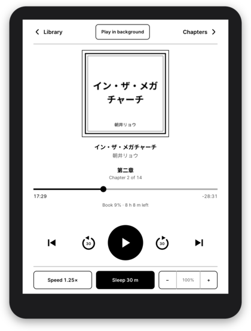
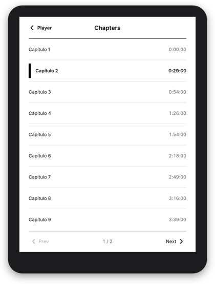
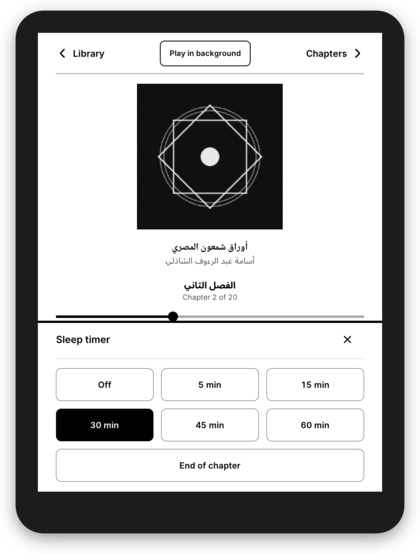
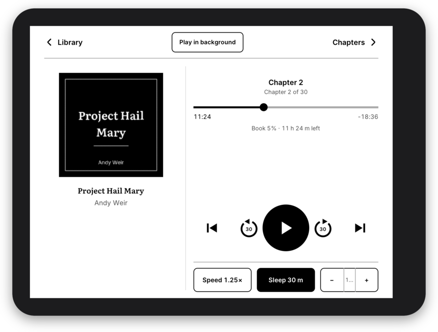

<p align="center">
  
</p>

<h1 align="center">Aloud</h1>

<p align="center">An audiobook player for jailbroken Kindles.</p>

<p align="center">
  <a href="https://github.com/NoureldinAmer/aloud/releases/latest"><strong>Download</strong></a> ·
  <a href="#install">Install</a> ·
  <a href="#features">Features</a> ·
  <a href="./docs/DEVICE-TESTING.md">Troubleshooting</a> ·
  <a href="./CONTRIBUTING.md">Contributing</a>
</p>

<p align="center">
  <a href="https://github.com/NoureldinAmer/aloud/releases/latest"></a>
  <a href="https://github.com/NoureldinAmer/aloud/actions/workflows/ci.yml"></a>
  <a href="./LICENSE"></a>
  
</p>

<p align="center">
  
</p>

Aloud turns a jailbroken Kindle into an audiobook player. Copy your DRM-free `.m4b` or
`.mp3` books over, tap **Aloud**, and listen over Bluetooth, even while you read.

## Features

- **M4B and MP3:** single files with chapters, or folders of chapter files. Covers and tags are read automatically.
- **Listen while reading:** keeps playing in the Kindle reader or KOReader.
- **Never loses your place:** positions survive crashes and dead batteries.
- **0.75× to 3× speed** with no chipmunk voice, plus a **sleep timer** that fades out.
- **Any language:** Latin, Greek and Cyrillic built in; optional font packs add العربية, 日本語 and 中文.
- **Made for e-ink:** a clean black-and-white UI with no flashing while you listen.

## See it in action

<p align="center">
  https://github.com/user-attachments/assets/4f05b56b-e85a-4ad6-b330-8f1196b8b5f3

  


  
</p>

## Light on your Kindle

| | |
| --- | --- |
| **Paused** | Zero CPU use. |
| **Playing** | Only the clock redraws, with a fast partial refresh. |
| **Memory** | 4.7 MB peak on an 8.6-hour M4B. |
| **Download** | One 1.4 MB zip, no dependencies. |

## Screens

| Player · 日本語 | Chapters · Español | Speed · 中文 | Sleep timer · العربية |
| :---: | :---: | :---: | :---: |
|  |  |  |  |

| Landscape | Kindle Touch (167 ppi) |
| :---: | :---: |
|  |  |

## Install

Needs a **jailbroken Kindle on firmware 5.x** with the hotfix ([how to jailbreak](https://kindlemodding.org)).

1. Download the zip from [Releases](https://github.com/NoureldinAmer/aloud/releases/latest).
2. Unzip it onto the Kindle's USB drive.
3. Put your audiobooks in the new `audiobooks/` folder.
4. Eject and tap **Aloud** in your library.

**Arabic, Chinese or Japanese titles?** Also download `aloud-fonts-arabic` (0.3 MB) or
`aloud-fonts-chinese-japanese` (4 MB) from the same release and unzip it the same way.

KUAL is optional. Using KOReader? Copy `extensions/aloud/koreader/aloud.koplugin` into `koreader/plugins/`.

### Which Kindles work?

| Kindle | Audio | Status |
| --- | --- | --- |
| Paperwhite 5 | Bluetooth | ✅ Tested (FW 5.19.2) |
| Kindle 8th gen+, Paperwhite 4 & 6, Oasis, Scribe, Colorsoft | Bluetooth | Should work, please [report](https://github.com/NoureldinAmer/aloud/issues/new?template=device_report.yml) |
| Kindle Touch | Jack, speaker | Should work, please report |
| Paperwhite 1–3, Voyage, Kindle 7th gen | — | No audio hardware |

## FAQ

**Audible books?** No, DRM-free files only (e.g. [LibriVox](https://librivox.org) or your own).

**Will it break my Kindle?** No. It changes no system files and always restores the Kindle
screen on exit. To remove it, delete `extensions/aloud/` and `documents/Aloud.sh`.

**Something's wrong.** Run **KUAL → Aloud Audiobook Player → Save Device Diagnostics** and
attach `aloud-diagnose.txt` to a [device report](https://github.com/NoureldinAmer/aloud/issues/new?template=device_report.yml).

## Build from source

You need [Zig](https://ziglang.org) 0.17+ (used as the C cross-compiler) and FFmpeg on the
host to generate test files. Works on macOS and Linux.

```bash
./scripts/fetch-deps.sh            # pinned FBInk, FFmpeg, sonic, stb and fonts
./scripts/build-ffmpeg.sh host
./scripts/build-ffmpeg.sh kindle
make test                          # 237 unit and integration checks
make package                       # → dist/aloud-<version>.zip + font packs
```

`make sim` runs the UI without a Kindle; `make showcase` and `make demo-video` rebuild this
README's images and video. Design notes: [ARCHITECTURE.md](./docs/ARCHITECTURE.md),
[RESEARCH.md](./docs/RESEARCH.md).

## Contributing

Issues, device reports and pull requests are welcome; see [CONTRIBUTING.md](./CONTRIBUTING.md).
Questions and ideas go in [Discussions](https://github.com/NoureldinAmer/aloud/discussions).

## License

[GPL-3.0-or-later](./LICENSE). Aloud uses [FBInk](https://github.com/NiLuJe/FBInk),
[FFmpeg](https://ffmpeg.org), [sonic](https://github.com/waywardgeek/sonic),
[stb](https://github.com/nothings/stb), and the [Literata](https://github.com/googlefonts/literata),
[Inter](https://github.com/rsms/inter), [Noto Arabic](https://github.com/notofonts/arabic) and
[Noto CJK](https://github.com/notofonts/noto-cjk) fonts (OFL-1.1).

<sub>Aloud is not affiliated with Amazon. Kindle is a trademark of Amazon.com, Inc.</sub>
