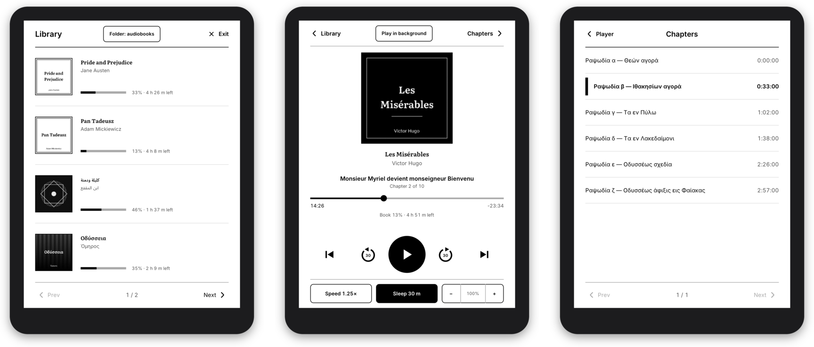
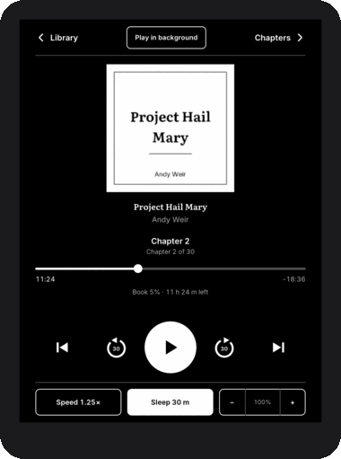
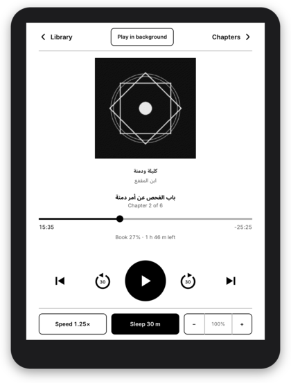
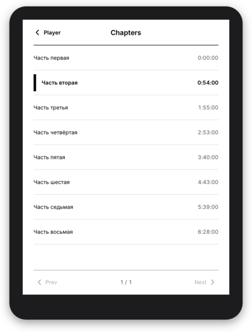
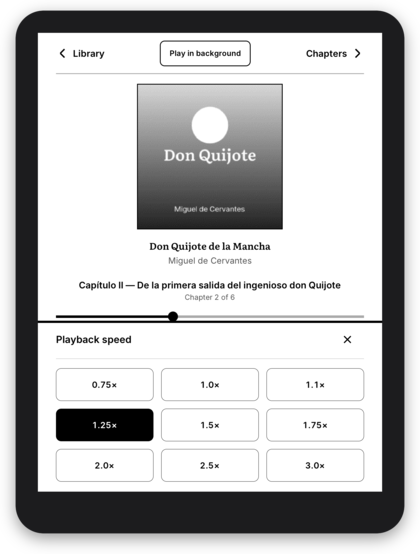
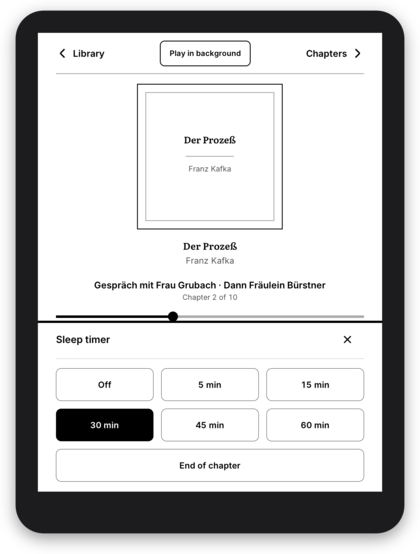
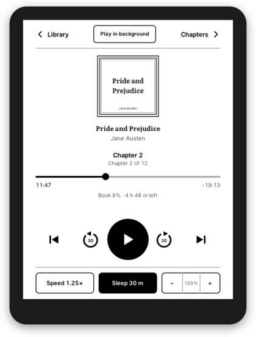
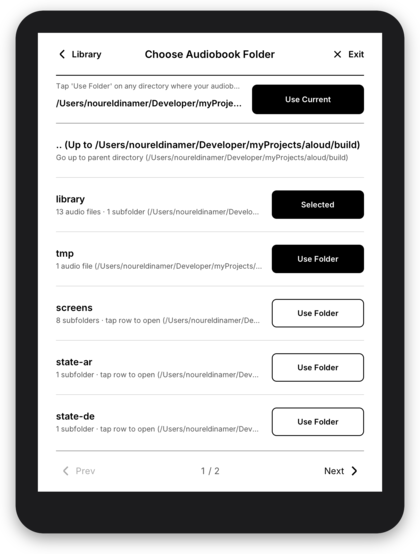

<p align="center">
  
</p>

<h1 align="center">Aloud</h1>

<p align="center">An audiobook player for jailbroken Kindles.</p>

<p align="center">
  <a href="https://github.com/NoureldinAmer/aloud/releases/latest"><strong>Download</strong></a> ·
  <a href="#install">Install</a> ·
  <a href="#features">Features</a> ·
  <a href="./docs/DEVICE-TESTING.md">Troubleshooting</a> ·
  <a href="./CONTRIBUTING.md">Contributing</a>
</p>

<p align="center">
  <a href="https://github.com/NoureldinAmer/aloud/releases/latest"></a>
  <a href="https://github.com/NoureldinAmer/aloud/actions/workflows/ci.yml"></a>
  <a href="./LICENSE"></a>
  
</p>

<p align="center">
  
</p>

Aloud turns your Kindle into an audiobook player. Copy your own DRM-free `.m4b` or `.mp3`
audiobooks to the Kindle, tap **Aloud**, and listen over Bluetooth headphones or a speaker.
Keep listening while you read in the Kindle's own reader or in KOReader.

It is a small native app written in C, designed for e-ink and for the Kindle's weak CPU and
small battery. The download is about 2 MB.

## Features

- **M4B and MP3, done right.** Single-file books with embedded chapters (`.m4b`, `.m4a`,
  `.mp3`, `.ogg`, `.opus`, `.flac`) and folders of chapter files, sorted naturally so
  `Chapter 2` comes before `Chapter 10`. Cover art and tags are read automatically.
- **Listen while you read.** Tap **Play in background** and go back to your book. Pause or
  skip 30 seconds from the KUAL menu or from KOReader, at no cost to battery while you read.
- **Never loses your place.** Every book remembers its position. Saves are atomic with a
  backup copy, so a crash, a dead battery, or a pulled cable can't corrupt them. Resuming
  rewinds 2 seconds so you don't miss a word.
- **Speed and sleep timer.** `0.75×` to `3×` without the chipmunk voice. Sleep after 15 to
  90 minutes or at the end of the chapter, with a gentle 10-second fade-out.
- **Your language.** Titles and chapters in Latin, Greek, Cyrillic and Arabic scripts,
  including right-to-left Arabic with proper letter joining.
- **Made for e-ink.** A calm black-and-white interface sized in real millimetres, so it
  looks right on 300 ppi Paperwhites and Oasis models, the 167 ppi Kindle Touch, and in
  landscape. Cover art is dithered to the panel's 16 grays.

<p align="center">
  
</p>

## Light on your Kindle

Kindles have 256–512 MB of RAM and a slow CPU, and you want the battery to last. Aloud is
built for that:

| | |
| --- | --- |
| **Paused** | Zero CPU wake-ups. The app sleeps until you touch the screen. |
| **Playing** | Only the clock and progress bar redraw, with a fast partial refresh. Nothing redraws while the screensaver is on or you're reading. |
| **Memory** | 4.7 MB peak on an 8.6-hour M4B (FFmpeg's default reader used 113 MB for the same file). |
| **Sleep** | The screensaver still comes on. Deep sleep waits until you pause or the timer ends. |
| **Download** | One 2 MB zip. No runtime, no dependencies to install. |

## Screens

| Player | Chapters | Speed | Sleep timer |
| :---: | :---: | :---: | :---: |
|  |  |  |  |

| Landscape | Kindle Touch (167 ppi) | Choose a folder |
| :---: | :---: | :---: |
|  |  |  |

## Install

You need a **jailbroken Kindle on firmware 5.x** with the hotfix installed. If you haven't
jailbroken yet, follow [kindlemodding.org](https://kindlemodding.org).

1. Download `aloud-x.y.z.zip` from [Releases](https://github.com/NoureldinAmer/aloud/releases/latest).
2. Plug in the Kindle and unzip the file onto the root of its USB drive. You get
   `documents/Aloud.sh`, `extensions/aloud/`, and an `audiobooks/` folder.
3. Copy your audiobooks into `audiobooks/`: one file per book, or one folder per book.
4. Eject, then tap **Aloud** in your Kindle library, or open it from **KUAL → Aloud**.

The library launcher works on every 5.x firmware, including 5.19.4 and later where KUAL
can't start apps on its own.

### Which Kindles work?

| Kindle | Audio out | Status |
| --- | --- | --- |
| Paperwhite 5 (11th gen) | Bluetooth | Tested (FW 5.19.2) |
| Kindle 8th–12th gen, Paperwhite 4 & 6, Oasis 1–3, Scribe, Colorsoft | Bluetooth | Should work. Please [report](https://github.com/NoureldinAmer/aloud/issues/new?template=device_report.yml) |
| Kindle Touch (4th gen) | Headphone jack, speaker | Should work. Please report |
| Paperwhite 1–3, Voyage, Kindle 7th gen | None | No audio hardware |

If something doesn't work on your model, run **KUAL → Aloud Audiobook Player → Save Device Diagnostics** and attach
`aloud-diagnose.txt` to a [device report](https://github.com/NoureldinAmer/aloud/issues/new?template=device_report.yml).
It masks your serial number and Bluetooth addresses, but read it before you post it.

### KOReader

If you read in KOReader, copy `extensions/aloud/koreader/aloud.koplugin` into
`koreader/plugins/`. You get Aloud controls in the Tools menu, and gestures you can bind to
play/pause and skip.

## FAQ

**Does it play Audible books?** No. Aloud plays DRM-free files only: books from
[LibriVox](https://librivox.org), stores that sell DRM-free audio, or your own CDs.

**Do I need KUAL?** No. Aloud starts from its icon in your Kindle library. KUAL adds the
background controls.

**Will it break my Kindle?** Aloud doesn't change any system files. When it exits, or
even if it crashes, the launcher gives the Kindle its normal screen back. To remove it,
delete `extensions/aloud/` and `documents/Aloud.sh`.

**Can I use the speaker?** Only the Kindle Touch has one. Other models need Bluetooth.

## Build from source

You need [Zig](https://ziglang.org) 0.17+ (used as the C cross-compiler) and FFmpeg on the
host to generate test files. Works on macOS and Linux.

```bash
./scripts/fetch-deps.sh            # pinned FBInk, FFmpeg, sonic, stb and fonts
./scripts/build-ffmpeg.sh host
./scripts/build-ffmpeg.sh kindle
make test                          # 228 unit and integration checks
make package                       # → dist/aloud-<version>.zip
```

`make sim` renders the UI on your computer without a Kindle. `make showcase` rebuilds the
images in this README. How it works is in [ARCHITECTURE.md](./docs/ARCHITECTURE.md), and
Kindle platform notes with sources are in [RESEARCH.md](./docs/RESEARCH.md).

## Contributing

Bug reports, device reports and pull requests are welcome. Reports from Kindle models we
haven't tested are the most useful thing you can send.

- Read [CONTRIBUTING.md](./CONTRIBUTING.md) before opening a pull request.
- Report bugs and request features in [Issues](https://github.com/NoureldinAmer/aloud/issues/new/choose).
- Ask questions and share ideas in [Discussions](https://github.com/NoureldinAmer/aloud/discussions).

## License

[GPL-3.0-or-later](./LICENSE). Aloud uses [FBInk](https://github.com/NiLuJe/FBInk),
[FFmpeg](https://ffmpeg.org), [sonic](https://github.com/waywardgeek/sonic),
[stb](https://github.com/nothings/stb), and the [Literata](https://github.com/googlefonts/literata),
[Inter](https://github.com/rsms/inter) and [Noto Arabic](https://github.com/notofonts/arabic)
fonts (OFL-1.1).

<sub>Aloud is not affiliated with Amazon. Kindle is a trademark of Amazon.com, Inc.</sub>
